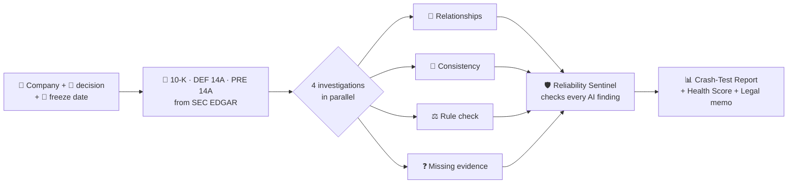

<p align="center">
  
</p>

<h1 align="center">Nirikkha · নিরীক্ষা</h1>

<p align="center">
  <b>Trust less, Verify more.</b><br>
  Governance Crash-Test AI — test the governance evidence behind a decision <i>before</i> you make it.
</p>

<p align="center">
  <a href="https://nirikkha.vercel.app"></a>
  <a href="https://nirikkha-api.onrender.com/docs"></a>
  <a href="https://nirikkha.vercel.app/docs"></a>
</p>

<p align="center">
  
  
  
  
  
  
  
  
  
</p>

<p align="center">
  <b>GovernanceIQ</b> challenge · International AI Builders Congress 2026 · JusticeSphere AI<br>
  Also covers <b>Risk Sentinel</b> and <b>Legal Copilot</b>
</p>

---

## The problem in one line

Governance failures are usually visible **in hindsight** — the warning signs sat in public filings all along,
spread across documents nobody had time to connect, and general AI tools summarise them without proof.

## What Nirikkha does

You pick a SEC-listed company and type the decision you are about to make —
*"Before we proceed with this partnership, identify the governance risks and evidence gaps we should investigate."*



| | |
|---|---|
| 🔍 **Evidence first** | Every finding links to the filing, page, section and the exact passage |
| ⚖️ **Governance Rule Engine** | 16 testable rules from Reg S-K Items 401, 402, 404, 407 → **Pass · Potential Gap · Fail · Insufficient Evidence** (law, best practice and risk indicators kept separate) |
| 🛡️ **AI Reliability Sentinel** | A second model checks each claim against its citation; doubtful findings go to human review |
| 📊 **Explainable Health Score** | Every deduction is listed; **Risk Severity ≠ Evidence Confidence**; insufficient evidence is shown, never counted as low risk |
| 🎯 **Decision-specific** | The investigation is built around the decision you typed |
| ⚖️ **Legal memo** | 3–5 non-obvious risks combining findings, every citation re-checked, English and বাংলা |

## Proof it works: the SVB First Warning Sign Replay

Nirikkha was run on **Silicon Valley Bank** using only filings public before **7 March 2023** — three days before the bank failed.

| Result | |
|---|---|
| Verdict | ✅ **VALID** — no citation dated after the freeze |
| Knowable warning signs raised | **5 of 5** (2 detected, 3 questioned) · **0 missed** |
| Not knowable from public data | 1 (confidential supervisory findings), reported honestly |
| Second independent run | VALID, 0 missed — the result is reproducible |
| Healthy-company control (Apple) | Health **85** vs SVB **68**; Apple misses 2 of the 5 SVB-type signs — it does not flag everyone |

Method and safeguards against hindsight: [`docs/REPLAY.md`](docs/REPLAY.md)

## More inside

| Feature | What it gives you |
|---|---|
| 📡 **Regulatory Change Radar** | Two data streams (SEC rule changes + new EDGAR filings), prioritised alerts, human **Approve / Reject** with audit trail, daily n8n schedule with Telegram alerts |
| 🕸️ **Relationship graph** | Directors, executives, committees and outside organisations in Neo4j, board interlocks, every edge backed by a quote |
| 🔒 **Private mode** | Every AI step on local Ollama models; it stops rather than falling back to the cloud |
| 🤖 **Nirikkha Guide** | Help chatbot in English and বাংলা, answers only from a curated help guide, no access to user or admin data |
| 🧩 **5 MCP servers** | Filings, rules, graph, crash-test, regulation — usable from any MCP client (stdio + Streamable HTTP) |
| 🌐 **Bilingual** | Full English / বাংলা interface and Bengali report and memo text |
| 💼 **Business model** | Pricing page with Free, Analyst Pro, Team and Enterprise plans |

## Numbers we measured

| Area | Result | Source |
|---|---|---|
| Retrieval | hit@1 **90%**, hit@3 **100%**, MRR **0.933** on gold questions | [`docs/EVALUATION.md`](docs/EVALUATION.md) |
| Graph extraction | **85%** of proposed relations verified against the source quote | [`docs/EVALUATION.md`](docs/EVALUATION.md) |
| Memo citations | pass rate **1.0** | [`docs/EVALUATION.md`](docs/EVALUATION.md) |
| PII redaction | **8/8** caught, **0/6** false changes | [`docs/EVALUATION.md`](docs/EVALUATION.md) |
| Private mode | full Crash-Test on an 8 GB CPU-only laptop in ~7 min | [`docs/LOCAL_MODELS.md`](docs/LOCAL_MODELS.md) |
| Cost | **$0.00** per analysis on free tiers (tokens logged per call) | [`docs/ARCHITECTURE.md`](docs/ARCHITECTURE.md) |

## Tech stack

| Layer | Tools |
|---|---|
| Frontend | Next.js, React, Tailwind CSS, Recharts, custom SVG — on **Vercel** |
| Backend | FastAPI, LangGraph, Pydantic — on **Render** (queue worker runs inside the API) |
| Data | Supabase Postgres + **pgvector**, Postgres full-text, **Neo4j Aura**, **DuckDB** |
| Retrieval | Semantic + contextual chunking, hybrid search with RRF, cross-encoder rerank, Graph RAG |
| Models | Groq (`gpt-oss-120b`, `gpt-oss-20b`, `gpt-oss-safeguard-20b`, `qwen3.8-27b`), Gemini 2.5 Flash, local Ollama (`qwen2.5:1.5b`, `gemma3:1b`), local ONNX (`bge-small-en-v1.5`, `ms-marco-MiniLM`) |
| Automation | n8n, 5 custom MCP servers, Cloudflare Tunnel |
| AI-assisted development | `AGENTS.md`, GitHub Spec Kit, Agent Skills, 5 frontend AI builders |

## Try it in 30 seconds

1. Open **https://nirikkha.vercel.app** → **Try the demo**
2. **Reports → Featured demos** → open the SVB report (frozen 7 Mar 2023)
3. Click any finding to see the exact passage, then **⚖️ Legal memo**
4. Visit **Replay**, **Graph** and **Radar**; switch to **বাংলা** at the top

> The free backend sleeps when idle — the first request can take about a minute. A new Crash-Test takes about 2–5 minutes.

## Run it locally

<details>
<summary><b>Frontend only</b> (no Python, no keys) — Windows / macOS</summary>

```powershell
git clone https://github.com/ShArafat58/nirikkha.git
cd nirikkha/frontend
cp .env.example .env.local      # PowerShell: Copy-Item .env.example .env.local
npm install
npm run dev
```

In `.env.local`: `NEXT_PUBLIC_USE_MOCK=true` for sample data, or `NEXT_PUBLIC_API_URL=https://nirikkha-api.onrender.com` for the live backend.
</details>

<details>
<summary><b>Full stack</b> — Python 3.12, Node.js, free Groq / Gemini / Supabase / Neo4j accounts</summary>

Windows:
```powershell
cd nirikkha\backend
python -m venv .venv
.\.venv\Scripts\Activate.ps1
pip install -r requirements.txt
Copy-Item .env.example .env        # your own keys; never commit .env
uvicorn app.main:app --port 8000   # terminal 1
python -m app.api.worker           # terminal 2 (or set EMBEDDED_WORKER=true)
```

macOS:
```bash
cd nirikkha/backend
python3 -m venv .venv && source .venv/bin/activate
pip install -r requirements.txt
cp .env.example .env
uvicorn app.main:app --port 8000
python -m app.api.worker
```

Run the SQL files in `backend/sql/` in number order, then start the frontend with `NEXT_PUBLIC_API_URL=http://localhost:8000`.
</details>

<details>
<summary><b>Optional parts</b> — Private mode, MCP, n8n, tunnel</summary>

| Part | How | Doc |
|---|---|---|
| Private mode | Install Ollama, `ollama pull qwen2.5:1.5b`, `ollama pull gemma3:1b` | [`docs/LOCAL_MODELS.md`](docs/LOCAL_MODELS.md) |
| MCP servers | `cd mcp-servers`, create a venv, `python smoke_test.py` | [`docs/MCP.md`](docs/MCP.md) |
| n8n workflows | Docker, import the JSON files | [`workflows/README.md`](workflows/README.md) |
| Public tunnel | `cloudflared tunnel --url http://localhost:5678` | [`docs/TUNNEL.md`](docs/TUNNEL.md) |
</details>

<details>
<summary><b>Tests</b></summary>

```powershell
cd backend
python -m pytest -q     # 234 tests, fake models, no network
cd ../frontend
npm run build
```
</details>

## Repository map

| Folder | What lives here |
|---|---|
| `frontend/` | Next.js app; talks to the backend only through the REST API |
| `backend/` | Ingestion, retrieval, LangGraph agents, rule engine, Sentinel, Replay, Radar |
| `mcp-servers/` | Five MCP servers |
| `workflows/` | n8n workflows (daily Radar scan, backend warm-up) |
| `specs/`, `.specify/` | GitHub Spec Kit constitution and feature specs |
| `skills/` | Agent skills |
| `docs/` | Everything below |

## Documentation

| | |
|---|---|
| [`ARCHITECTURE`](docs/ARCHITECTURE.md) — system design, model routes, deployment | [`DATA_LIFECYCLE`](docs/DATA_LIFECYCLE.md) — sources, storage, lineage, quality, privacy |
| [`REPLAY`](docs/REPLAY.md) — SVB method and results | [`ETHICS`](docs/ETHICS.md) — safeguards, biases, KPIs |
| [`EVALUATION`](docs/EVALUATION.md) — measured results | [`PROMPT_LIBRARY`](docs/PROMPT_LIBRARY.md) — versioned prompts |
| [`LOCAL_MODELS`](docs/LOCAL_MODELS.md) — Private mode | [`MCP`](docs/MCP.md) — servers built and used |
| [`API`](docs/API.md) — REST contract | [`AI_BUILDERS`](docs/AI_BUILDERS.md) · [`AI_DLC`](docs/AI_DLC.md) — how AI helped build it |
| [`SUBMISSION`](docs/SUBMISSION.md) — pitch and business model | [`TUNNEL`](docs/TUNNEL.md) — publishing local services |

## Responsible use

Nirikkha **does not accuse any company** of misconduct. A relationship or gap is a question to verify, not proof.
When public evidence is not enough, the report says **"Insufficient Evidence"**. It is decision support for analysts,
not legal or investment advice. The Apple partnership story in the pitch is hypothetical; the live demo uses real public SEC filings.

<p align="center"><sub>All keys live in git-ignored <code>.env</code> files · built on free tiers · <b>Trust less, Verify more.</b></sub></p>
