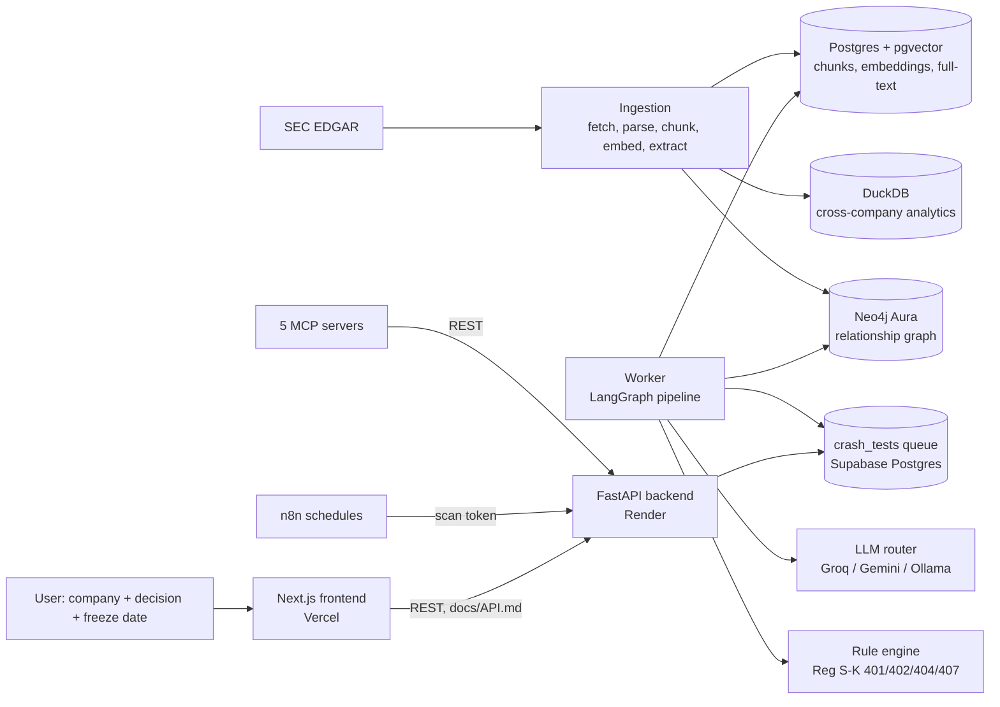

# Nirikkha architecture

Input: a SEC-listed company, an optional evidence freeze date, and the decision the user is about to make.
Processing: ingestion → retrieval → four investigations → rule engine → Reliability Sentinel → scoring.
Output: an evidence-linked Governance Crash-Test Report, a Health Score, and an optional legal memo.

## 1. Ingestion (`backend/app/ingest`, `backend/app/graph`)

| Step             | What happens                                                                                                                                                                                                                                                                                                                                                  | Code                                 |
| ---------------- | ------------------------------------------------------------------------------------------------------------------------------------------------------------------------------------------------------------------------------------------------------------------------------------------------------------------------------------------------------------- | ------------------------------------ |
| Fetch            | Form 10-K and DEF 14A / PRE 14A from SEC EDGAR with a contact User-Agent and request pacing under SEC's rate limit; raw files cached                                                                                                                                                                                                                          | `ingest/edgar.py`                    |
| Parse            | HTML/XBRL filings to text with page and section numbers kept for every paragraph                                                                                                                                                                                                                                                                              | `ingest/parse.py`                    |
| Chunk            | **Section-aware semantic chunking**: paragraphs are embedded and cut where consecutive paragraphs are least similar; mostly numeric tables are split by size only. Each chunk gets a **contextual header** (company, form, filing date, section, pages) that is embedded with the text (contextual chunking). A SHA-256 content hash removes duplicate chunks | `ingest/chunk.py`                    |
| Embed            | `BAAI/bge-small-en-v1.5` (384 dimensions) locally through fastembed / ONNX Runtime; vectors cached by hash                                                                                                                                                                                                                                                    | `rag/embeddings.py`                  |
| Extract          | An LLM proposes governance relations (director of, officer of, committee member/chair, outside board seat, employment, related party). Each relation must quote its source passage; a verifier keeps only relations whose quote is found in the chunk. Example: SVB 2022 proxy, 162 proposed, 137 verified                                                    | `graph/extract.py`                   |
| Resolve and load | Name merging (Tom → Thomas), committee name normalisation, table rows must name their committee before they count; then MERGE into Neo4j                                                                                                                                                                                                                      | `graph/resolve.py`, `graph/store.py` |

Data loaded for the demo: SVB Financial Group and Apple Inc., 9 filings, 1,949 chunks.

## 2. Retrieval (`backend/app/rag`)

1. **Hybrid search**: pgvector cosine similarity + Postgres full-text search over the same chunks.
2. **Reciprocal Rank Fusion** merges the two ranked lists.
3. **Cross-encoder rerank** of the top 20 candidates with `ms-marco-MiniLM-L-6-v2` (local, ONNX).
4. **Evidence freeze**: only filings published on or before the analysis date are searchable, which is what makes the Replay free of hindsight.
5. **Graph retrieval**: the Relationship investigation queries Neo4j (roles, committees, outside organisations, interlocks) and cites the passage stored on each relation (Graph RAG).

Regression set: 10 gold questions, hit@1 90%, hit@3 100%, MRR 0.933 (`docs/EVALUATION.md`).

## 3. The Crash-Test pipeline (`backend/app/agents/graph.py`, LangGraph)

| #   | Node             | Kind       | What it does                                                    |
| --- | ---------------- | ---------- | --------------------------------------------------------------- |
| 1   | redact           | rule       | Masks emails, phones, ID and card numbers in the decision text  |
| 2   | guard            | rule + LLM | Prompt-injection heuristic, then the safety model               |
| 3   | collect          | data       | Loads filings, graph facts and rules visible at the freeze date |
| 4   | plan             | LLM        | Turns the decision into investigation questions                 |
| 5   | gather           | retrieval  | Hybrid search + rerank for each question                        |
| 6   | analyze          | LLM        | Answers only from the retrieved passages, with citations        |
| 7   | relationship     | graph      | Potential conflicts and interlocks from Neo4j                   |
| 8   | consistency      | rule       | Cross-document and year-over-year changes                       |
| 9   | regulatory       | rule       | Rule engine (below)                                             |
| 10  | missing_evidence | rule       | Questions the public filings cannot answer                      |
| 11  | merge            | code       | Ranks and de-duplicates findings                                |
| 12  | sentinel         | LLM judge  | Reliability Sentinel checks every AI finding                    |
| 13  | score            | code       | Explainable Health Score                                        |

Investigations 7–10 run in parallel. Progress events stream to the frontend.
A queued design (API → `crash_tests` table → worker) keeps the API responsive and lets one worker serve many users.

## 4. Governance Rule Engine (`backend/app/rules`)

16 structured, testable rules. Each rule states its category (applicable law, best practice, internal risk indicator),
source (for example Reg S-K Item 407(d)(5)), required evidence, and a deterministic check.
Results: **Pass**, **Potential Gap**, **Fail**, **Insufficient Evidence**, or **Not applicable** with a reason
(for example, Chief Risk Officer and dedicated risk committee rules do not apply outside finance, decided from the company's SEC SIC code;
pay-versus-performance does not apply before its compliance date).
The rule engine makes no LLM calls, so it costs nothing and gives the same answer every time.

## 5. AI Reliability Sentinel (`backend/app/agents/sentinel.py`)

A second, stronger model (`openai/gpt-oss-120b`) checks each AI finding: does the cited passage support the claim,
is there contradictory evidence, is the source authoritative, is the reporting period correct, is the evidence enough.
Verdicts: verified, needs review, downgraded, unsupported. Anything not verified goes to the admin **Human review** queue.

## 6. Health Score (`backend/app/agents/score.py`)

Each investigation can remove at most 30 points. Every deduction is listed with the finding that caused it.
**Risk Severity** and **Evidence Confidence** are separate fields on every finding.
**Insufficient Evidence** items are listed separately and never counted as low risk; evidence coverage is shown next to the score.

## 7. LLM router (`backend/app/llm/client.py`)

Each task has an ordered route. Before calling a model the client checks that model's rate-limit budget, waits or skips,
and moves to the next model on errors or invalid JSON, so the demo does not stop when one free tier is exhausted.
Responses are cached, and every call is logged with task, provider, model, tokens, latency and cost.

| Task               | Primary                             | Fallbacks                                         | Why                                                |
| ------------------ | ----------------------------------- | ------------------------------------------------- | -------------------------------------------------- |
| reason             | Groq `openai/gpt-oss-120b`          | Gemini `gemini-2.5-flash`, local Ollama           | Planning and judging need the strongest open model |
| fast               | Groq `openai/gpt-oss-20b`           | Gemini `gemini-2.5-flash-lite`, local Ollama      | Cheap, quick structured steps                      |
| analyze            | Gemini `gemini-2.5-flash`           | Groq `openai/gpt-oss-120b`, local Ollama          | Long evidence context                              |
| extract            | Groq `qwen/qwen3.8-27b`             | Groq `openai/gpt-oss-20b`, then further fallbacks | Strong JSON extraction                             |
| safety             | Groq `openai/gpt-oss-safeguard-20b` | Groq `openai/gpt-oss-20b`                         | Purpose-built safety classifier                    |
| bangla             | Gemini `gemini-2.5-flash`           | Groq `qwen/qwen3.8-27b`                           | Better Bengali output                              |
| private (any task) | Ollama `qwen2.5:1.5b` / `gemma3:1b` | **none, fails closed**                            | No text leaves the machine                         |

Full routes: `ROUTES` in `client.py`. Prompts are versioned files in `backend/app/prompts/` (`docs/PROMPT_LIBRARY.md`).

## 8. Other services

| Feature                   | Design                                                                                                                                                                                   | Code / doc                                       |
| ------------------------- | ---------------------------------------------------------------------------------------------------------------------------------------------------------------------------------------- | ------------------------------------------------ |
| First Warning Sign Replay | Case file with dual dates (event date vs public date), freeze guard, leak check on citations, comparison statuses (detected, questioned, partial, missed, not knowable), control company | `app/replay`, `docs/REPLAY.md`                   |
| Regulatory Change Radar   | Two streams (curated SEC rule changes, new EDGAR filings in the last 365 days), rule-based priority, Approve/Reject with audit trail; scan protected by a shared token                   | `app/radar`, `workflows/`                        |
| Legal memo                | At least three non-obvious risks citing real rules; every citation re-checked; Bengali translation keeps ids, rules and quotes in English                                                | `app/agents/memo.py`                             |
| Help chatbot              | Answers only from `docs/HELP_KB.md`; no database or auth access; PII redaction; rate limit; FAQ fallback                                                                                 | `app/api/help.py`                                |
| Analytics                 | DuckDB snapshot for cross-company and cross-year queries                                                                                                                                 | `app/analytics`, `backend/data/analytics.duckdb` |
| MCP                       | Five FastMCP servers over stdio and Streamable HTTP calling the REST API                                                                                                                 | `mcp-servers/`, `docs/MCP.md`                    |
| Auth                      | argon2id password hashes, JWT sessions; admin sessions expire in 2 h and need a 30-minute step-up for admin actions                                                                      | `app/auth`                                       |

## 9. Deployment

| Part           | Where                               | Notes                                                  |
| -------------- | ----------------------------------- | ------------------------------------------------------ |
| Frontend       | Vercel (free)                       | Auto-deploys from `main`                               |
| API            | Render (free)                       | Sleeps when idle; n8n pings `/health` every 10 minutes |
| Worker         | Developer machine (or any server)   | Same code as the API; claims queued jobs               |
| Database       | Supabase Postgres + pgvector (free) | Migrations in `backend/sql/`                           |
| Graph          | Neo4j Aura Free                     |                                                        |
| Local services | n8n (Docker), Ollama, MCP servers   | Published on demand with Cloudflare quick tunnels      |

## 10. Reliability and cost

- No single point of failure in the model layer: per-task fallbacks across two cloud providers and a local runtime.
- Precomputed demo reports and cached analyses (same company, date and decision return the stored report).
- Token, latency and cost logged per call and per report; the report shows LLM calls, tokens and cost.
  On free tiers the measured cost is $0.00; for example an Apple Crash-Test used 5 LLM calls and 13,079 tokens.
- 234 backend tests with fake models and no network; `npm run build` for the frontend.

## 11. Scaling path

- More workers on the same queue; the API stays stateless.
- New jurisdictions as new ingestion sources (Companies House, GLEIF) and new rule packs; rules are data plus small checks.
- Enterprise install: same containers on the customer's servers with Private mode and approved private documents.
